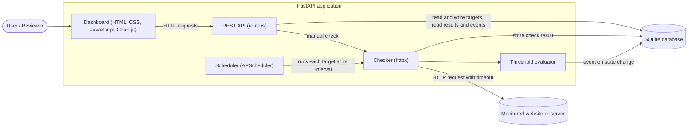
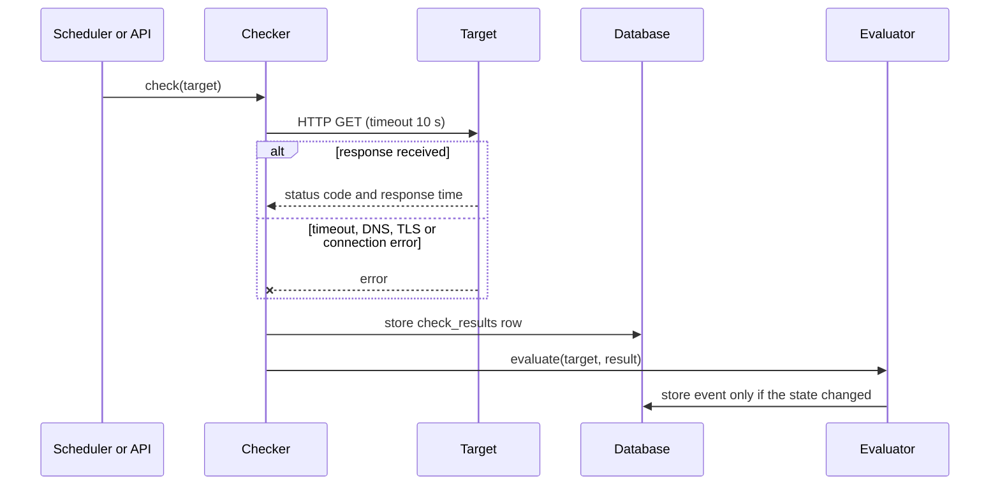
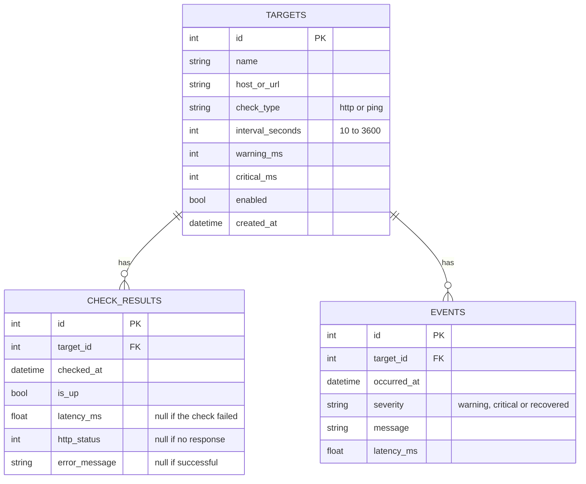
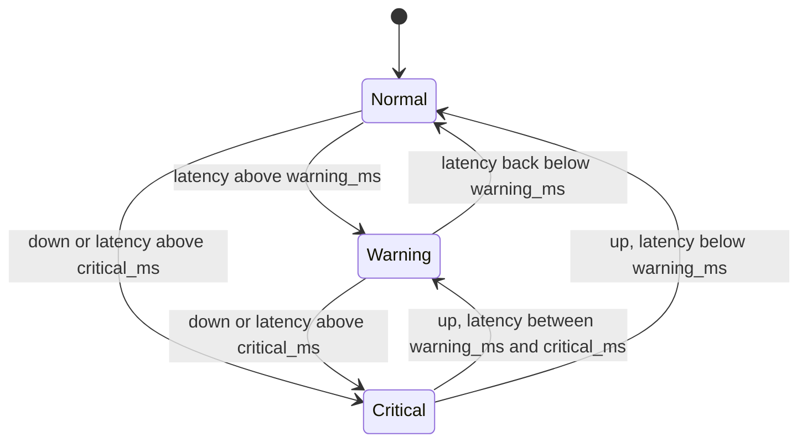

# System Design

This document contains the database schema (ER diagram) and the system architecture. The diagrams are written in Mermaid, which GitHub renders automatically.

## 1. Architecture

The system has four components. The **scheduler** triggers a check for each enabled target at its own interval. The **checker** performs the HTTP check and measures the result. The **API** exposes targets, results, events and summaries. The **dashboard** reads from the API and displays status and history. All data is stored in SQLite.

### Components and status

| Component | Module | Responsibility | Status |
|-----------|--------|----------------|--------|
| API | `app/main.py`, `app/routers/targets.py` | Target CRUD, manual check, results listing, readable validation errors | Built (Week 1) |
| Data layer | `app/database.py`, `app/models.py` | SQLite connection and ORM tables | Built (Week 1) |
| Validation | `app/schemas.py`, `app/errors.py` | Input rules and response shapes | Built (Week 1) |
| Checker | `app/checker.py` | HTTP check with timeout and error handling; stores a result | Built (Week 1) |
| Scheduler | `app/scheduler.py` | Runs checks in the background per target interval; follows target add, edit and delete | Built (Week 2) |
| Threshold evaluator | planned | Compares latency to thresholds and creates events on state change | Week 2 |
| Dashboard | planned | Status, history chart, forms, events, report export | Week 3 |

### Check flow

The manual check endpoint (`POST /targets/{id}/check`) uses the same checker. The evaluator step is added in Week 2.

## 2. Database schema

### Table notes

- **targets**: one row per monitored website or server. `warning_ms` must be lower than `critical_ms`.
- **check_results**: one row per check, successful or not. A failed check has `is_up = false`, no latency, and an `error_message`. A response with status 400 or above is also `is_up = false`, but keeps its latency and `http_status`.
- **events**: one row per state change, not per check.
- Deleting a target deletes its check results and events (cascade).
- `check_results.target_id`, `check_results.checked_at`, `events.target_id` and `events.occurred_at` are indexed, since history and uptime queries filter on them.
- Timestamps are stored in UTC.

## 3. Target state model

Events are created only when the state changes, so repeated failures produce one event, not one per check.

Entering **Warning** or **Critical** creates a `warning` or `critical` event. Returning to **Normal** from either creates a `recovered` event. Moving from Critical to Warning is treated as an improvement and also creates a `warning` event, so the log shows the target is still degraded. The exact rules are finalised with the evaluator in Week 2.
